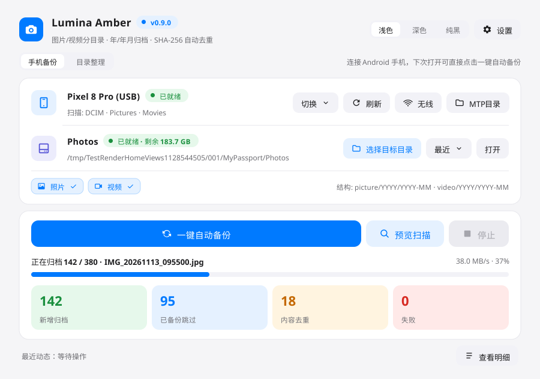
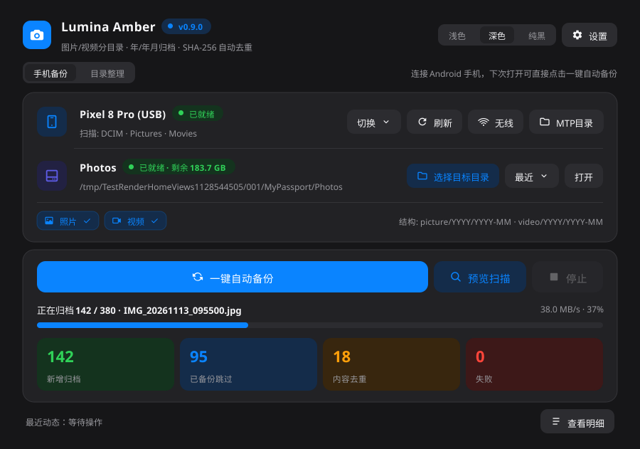

# Lumina Amber (光珀)

<p align="center">
  
  
  
  
  
  
</p>

<p align="center">
  <b>An Offline-First Android Photo & Video Backup and Local Archive Organizer for Linux & macOS</b><br/>
  <i>Pure Go · Dual-Tier SHA-256 Deduplication · Portable Drive Metadata · Concurrent I/O Pipeline · Zero Telemetry</i>
</p>

<p align="center">
  <b>English</b> | <a href="doc/README_CN.md">简体中文</a>
</p>

---

## Screenshots

| macOS Light | macOS Dark |
| :---: | :---: |
|  |  |

---

## Key Features

- **100% Offline & Private**: Zero analytics, zero telemetry, zero network calls — all indexing and hashing run locally.
- **Two Workflows in One App**:
  - **Phone Backup**: Connects to Android phones via **ADB (USB & Wireless)** or **Mounted Folder / Linux GVFS MTP** with fast single-shot discovery and remote `sha256sum` pre-checks.
  - **Folder Import & Organize**: Recursively scans any local or external folder and imports media into your unified archive (Copy or verified Move mode).
- **Structured Media Hierarchy (`picture/` & `video/`)**:
  - Photos -> `<Target>/picture/<YYYY>/<YYYY-MM>/<Filename>`
  - Videos -> `<Target>/video/<YYYY>/<YYYY-MM>/<Filename>`
  - Capture date priority: EXIF `DateTimeOriginal` -> MP4/MOV `mvhd` atom -> validated filename patterns -> file modification time.
- **Portable Target Metadata (`<Target>/meta/index.db`)**:
  - Stores relative paths, SHA-256 hashes, and sync history inside the destination directory itself, so plugging an external drive into another computer or switching to a new backup drive works out of the box.
- **Dual-Tier Deduplication & Collision Safety**:
  - **Tier 1 (Incremental Cache)**: Skips unchanged source files immediately via source metadata cache.
  - **Tier 2 (Content SHA-256)**: Prevents duplicate copies even across renamed files or multiple phones; files with matching names but different bytes are safely suffixed (`_1`, `_2`, ...).
- **High-Throughput Concurrency**:
  - Bounded worker pools, `sync.Pool` 1 MiB I/O buffers, single-pass `copyAndHashFile` (`io.MultiWriter`), O(1) in-memory snapshot lookups, and 64-item batched SQLite commits with deterministic ordering.
- **External Drive Guard & Remembered Defaults**:
  - Detects unmounted external mount points on Linux (`/media`, `/run/media`) and macOS (`/Volumes`), and persists your last device, target drive, media filters, and theme (`Light` / `Dark` / `AMOLED`).

---

## Building & Running

### Prerequisites
- **Go 1.24+** with CGO enabled
- **Linux**: GCC and OpenGL/X11 development headers (`libgl1-mesa-dev`, `xorg-dev`, `libxxf86vm-dev`)
- **macOS**: Xcode Command Line Tools (`xcode-select --install`)
- **Optional**: Android `adb` (`platform-tools`) on `PATH` for USB / Wireless ADB mode

### Linux
```bash
make test
make build-linux
./bin/lumina-amber-linux-amd64 -version
./bin/lumina-amber-linux-amd64
```

### macOS (Universal `.app` Bundle)
On a Mac, or automatically via GitHub Actions (`macos-latest`):
```bash
CGO_ENABLED=1 GOARCH=arm64 go build -ldflags="-s -w" -o bin/macos/lumina-amber-arm64 ./cmd/lumina-amber
CGO_ENABLED=1 GOARCH=amd64 go build -ldflags="-s -w" -o bin/macos/lumina-amber-amd64 ./cmd/lumina-amber
lipo -create -output bin/macos/lumina-amber bin/macos/lumina-amber-arm64 bin/macos/lumina-amber-amd64
./scripts/package-mac.sh bin/macos/lumina-amber
```

---

## GitHub Actions & Releases

- **CI (`.github/workflows/ci.yml`)**: Automatically runs `go vet`, `-race` unit tests, UI/CLI package tests, and produces both Linux `amd64` and macOS Universal `.app` build artifacts on pushes and pull requests to `main`.
- **Release (`.github/workflows/release.yml`)**: Pushing a version tag (e.g. `git tag v0.9.0 && git push origin v0.9.0`) triggers automated builds for Linux and macOS, generates `SHA256SUMS.txt`, and publishes a GitHub Release.

---

## License & Attribution

- **Author**: `eddy` (Lumina personal software series)
- **License**: [GNU General Public License v3.0](LICENSE)
